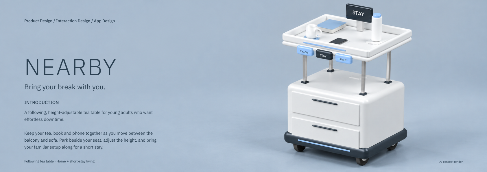
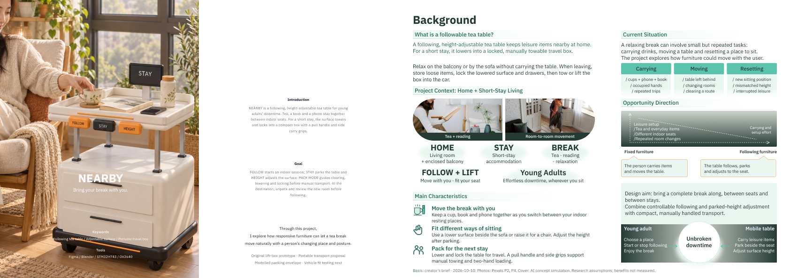
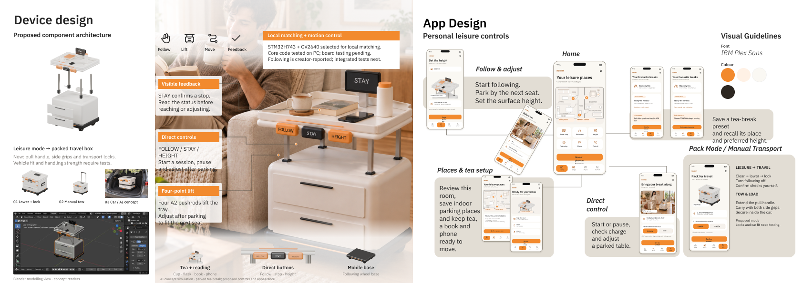
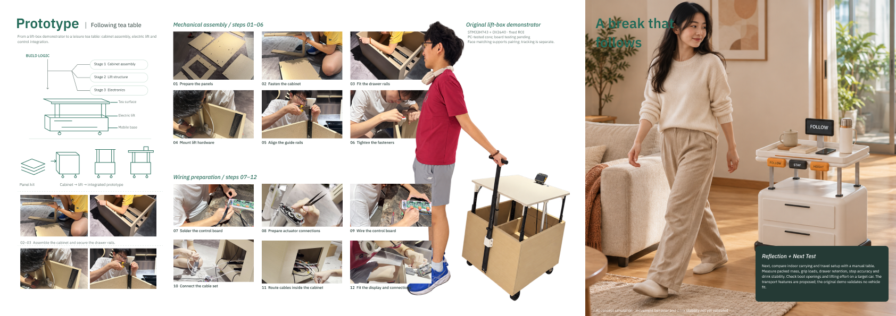

# NEARBY — Bring Your Break With You

A following, height-adjustable tea table for young adults who want effortless downtime at home or during a short stay. Keep a drink, book and phone together as you move between a balcony and a sofa; park the table and adjust its surface to your seat.

**Current portfolio:** one cover + six content boards · 1684 × 595 px · IBM Plex Sans · pale blue, white and dark blue.

[Editable Figma project](https://www.figma.com/design/ApoghdbZoRBlbBcDctaMXf/Untitled?node-id=383-3293) · [Current seven-page PDF](exports/NEARBY_Current_Portfolio.pdf) · [Offline STM32 recognition repository](https://github.com/leviastudio925-collab/nearby-stm32h743-offline-face)

## Latest portfolio

Snapshots synchronized from Figma on **2026-10-12**. Figma remains the editable design source. The PDF contains the new cover followed by these six content snapshots.

| Board | Content | Preview |
| --- | --- | --- |
| 00 | Minimal product cover and introduction | [PNG](previews/board-00-cover.png) |
| 01 | Introduction, background and tabletop-height research | [PNG](previews/board-01.png) |
| 02 | Leisure scenarios, user groups and journey | [PNG](previews/board-02.png) |
| 03 | Design concept and technical research | [PNG](previews/board-03.png) |
| 04 | System design, touchpoints and indoor routes | [PNG](previews/board-04.png) |
| 05 | Device design, room presets and app controls | [PNG](previews/board-05.png) |
| 06 | Physical assembly, wiring and reflection | [PNG](previews/board-06.png) |

## Interaction

- **FOLLOW:** request movement to the next indoor resting place.
- **STAY:** pause and park before reaching for items.
- **HEIGHT:** adjust the surface after parking.
- **Room presets:** choose living room, balcony or short-stay studio; save a place and preferred surface height.
- **Manual transport concept:** lower, clear and lock the table before towing or loading. Travel handling and locks require further testing.

## Project files

- `models/`: Blender product models and scene metadata.
- `assets/`: renders, room presets, icons, reference photographs and prototype documentation.
- `firmware/offline-face/`: C recognition core, STM32 HAL integration examples and tests.
- `scripts/`: model, rendering and media preparation scripts.
- `previews/`: current board snapshots and development previews.
- `exports/`: current PDF and earlier exports retained as design history.
- `source-demo/`: original prototype presentation and demonstration video.
- `docs/`: historical research and handoff notes. Several documents describe the earlier care-oriented concept; use the current boards and this README for the latest project positioning.

## Prototype status

The physical lift-box demonstrator uses a cabinet, electric lift structure and mobile base. The selected recognition hardware is STM32H743 + OV2640. The supplied C recognition core performs offline face-template matching within a fixed framing region; it does not implement automatic face detection, neural-network recognition or liveness detection. Its tests have run on a PC; board deployment and measured recognition performance remain to be verified.

Face matching and continuous person following are separate tasks. The app, room presets, integrated following behaviour and compact transport features are design proposals requiring hardware integration and validation. [Read the firmware integration guide](firmware/offline-face/README.md).

## Images and sources

Assembly photographs and wiring-video frames document the creator's prototype. Product lifestyle scenes are labeled AI concept simulations. Stock photographs illustrate leisure scenarios and are not participant research evidence.

Context-photo sources are recorded in [the source register](assets/photo-refresh/source-register.json) and their Figma layer names. Tabletop-height research uses cited IKEA product examples. Technical references include STMicroelectronics, Bansbach, Pololu and LINAK.

Third-party material retains its original rights. This repository does not grant a blanket redistribution or open-source license over third-party assets.

