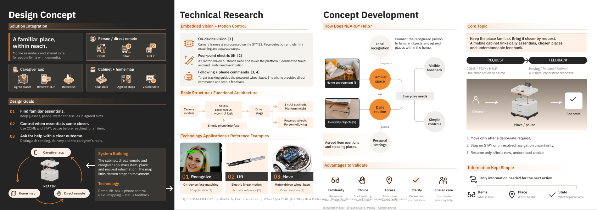

# NEARBY — Mobile Essentials & Shared Care

An interaction and service design portfolio exploring a familiar, mobile storage cabinet for people living with dementia and their caregivers.

**Portfolio:** six boards, 1684 × 595 px · English layout · IBM Plex Sans · Warm orange `#F28A2E`

[Open the editable Figma project](https://www.figma.com/design/ApoghdbZoRBlbBcDctaMXf/Untitled?node-id=84-252)

## Current portfolio snapshot

The six PNG previews below were exported from the current Figma boards on **2026-10-09**. Figma is the current editable layout source; the PDF in `exports/` is an earlier export and does not include every subsequent layout revision.

| Board | Content | Preview |
| --- | --- | --- |
| 01 | Cover, background & home context | [PNG](previews/board-01.png) |
| 02 | Research framing & everyday journey | [PNG](previews/board-02.png) |
| 03 | Design concept, technical research & concept development | [PNG](previews/board-03.png) |
| 04 | System design, touchpoints & simulated home map | [PNG](previews/board-04.png) |
| 05 | User flow & interface design | [PNG](previews/board-05.png) |
| 06 | Prototype, service & validation plan | [PNG](previews/board-06.png) |

## Project files

- `models/`: editable Blender product model and scene manifest.
- `assets/`: product renders, home mapping illustration and attributed contextual / technology references.
- `docs/`: Chinese project structure, research notes, user journey, technical research and handoff documentation.
- `scripts/`: existing Blender construction and rendering scripts.
- `source-demo/`: original prototype presentation and demonstration video.
- `exports/`: earlier PDF and overview export, retained as a versioned reference.
- `previews/`: current Figma board snapshots.

[中文项目结构](docs/NEARBY_中文项目结构.md) · [第三面及技术资料](docs/NEARBY_第三面结构.md) · [用户体验结构](docs/NEARBY_用户体验结构.md) · [纪录片观察](docs/NEARBY_纪录片观察.md)

## Prototype configuration and evidence

The creator confirmed the following prototype configuration on 2026-10-09:

- Face-recognition AI runs locally on STM32, with a camera module.
- Four A2 motor electric linear actuators control platform height.
- A powered wheel base can follow a person.
- A simple phone interface connects to the device.

The exact STM32 part, actuator manufacturer and ratings, AI model and recognition metrics, following algorithm and measured motion performance remain undocumented. External ST, actuator and wheel-base illustrations are technology references; they do not identify the original prototype parts.

The dementia-care product, COME / STAY / HELP interaction, caregiver UI, household map, navigation rules and service model are design proposals. Stock and documentary images illustrate contexts; they are not original fieldwork evidence. Expected benefits are directions for validation, not established clinical or usability results. Older documents may predate the hardware clarification above.

## Sources and attribution

Research and image links are retained in the Chinese documentation and in the Figma footers. Contextual photographs include Pexels images by George Milton and Rachel Claire. Technical references include STMicroelectronics, Bansbach, Pololu and LINAK. Documentary reference material is discussed in `docs/NEARBY_纪录片观察.md`.

Third-party material retains its original rights. No blanket open-source or redistribution license is granted by this repository.
